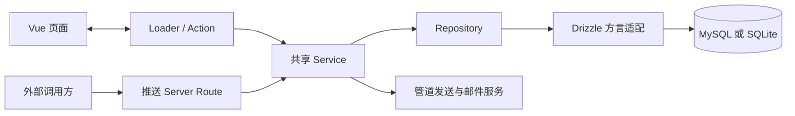

# 整体架构

## 目标

提供单实例消息推送中心：用户在同一个站点管理房间、管道、模板和消息记录，外部调用方通过兼容旧版的推送 URL 投递消息。MySQL 与 SQLite 使用同一套业务服务。

## 边界

- 应用运行于 Node，使用 Void Pages、Vue 和 Nuxt UI；Dashboard 模板仅作组件与视觉设计参考，不复制或依赖其应用代码。
- Void 是唯一的页面路由与布局运行机制，不初始化 Vue Router。页面数据读取与写操作统一使用 Loader / Action。
- 管理功能通过页面 Loader / Action 提供。对外业务 API 仅保留两个消息推送 Server Route，其他旧管理 API 不再保留。
- Service 接收业务输入和身份信息，不接收 HTTP Context，不设置 Cookie，也不构造页面响应。
- Vue 组件通过页面 Props、Form 和 Action 操作数据。数据库连接、JWT 签名、邮件凭据及服务端实现不进入客户端。
- 当前部署单位为一个应用实例和一个选定的数据库；没有消息队列、独立 Worker 或多实例协调服务。

## 规则

### 页面入口

| 页面 | 职责 |
| --- | --- |
| `/login` | 登录及注册 / 找回密码邮件 |
| `/` | 当前用户的统计概览 |
| `/account` | 当前账号及修改密码 |
| `/rooms`、`/rooms/:id` | 房间维护、管道关联、页面发送及消息历史 |
| `/channels`、`/channels/:id` | 管道维护、测试及投递历史 |
| `/templates` | 模板维护、结构化编辑和草稿预览 |
| `/admin` | 校验管理员身份后跳转到全局仪表盘 |
| `/admin/dashboard` | 全局统计和图表 |
| `/admin/user` | 用户列表、创建、角色调整和删除 |
| `/admin/db` | 系统模板重置和数据库重置 |

Loader 承担页面查询、筛选及分页；Action 承担校验后的写入和操作。页面授权、输入校验和业务错误使用 HTTP 语义；旧推送入口使用独立的兼容响应协议，见[消息投递](message-delivery.md)。

- `/login` 始终使用居中的登录布局，不显示后台侧栏，即使浏览器仍带有有效会话 Cookie。
- 后台使用 Nuxt UI Dashboard 布局组件、主导航和侧栏底部用户菜单，自行实现 Void Pages 的导航状态；没有模板搜索、Feedback 或帮助入口。
- 主导航提供概览、房间、管道、模板和账号入口；管理员的“系统管理”是主导航中的嵌套菜单，包含三个独立管理页面。每页独立 Loader / Action 并验证管理员权限，不跨职责加载用户列表或统计。
- 侧栏使用 rem 作为尺寸单位，限制可调宽度范围，并通过 Nuxt UI 本地存储保存布局尺寸与折叠状态。
- 右侧面板只渲染页面内容；移动端在内容区提供菜单按钮，没有额外应用顶栏。成功导航、历史导航或锚点变化后关闭移动端侧栏。
- Nuxt UI 站内链接通过其插件的 router 回调交由 Void 导航；普通链接及分页使用 Void Link。修饰键、新窗口、下载及站外链接保留浏览器行为。
- 导航高亮依据 Void 当前 URL 路径计算，详情页归属对应列表入口，系统管理按子页面路径选中子项。菜单、用户信息与移动端侧栏状态归属布局，随共享身份响应式更新。折叠时隐藏品牌链接，顶部只保留居中的方形折叠按钮。
- 搜索通过 Void 导航更新查询参数并回到第一页；列表和历史使用类型化 UTable，筛选与分页由 Loader 完成，不执行额外客户端排序或分页。
- 用户名按钮打开下拉菜单，菜单提供账号设置和退出登录。退出通过受 CSRF 保护的 Action 清除会话 Cookie 并跳转到登录页。

### 统计展示

- 首页展示每日消息折线、房间消息占比及管道发送占比；全局仪表盘展示每日消息折线、用户消息占比及当前管道类型占比。用户标签使用用户名。
- 时间周期默认 7 天，允许 1–60 天整数，通过 Void 导航修改 `days` 查询参数并重新执行 Loader；服务端拒绝越界或非法值。周期只影响消息及发送历史，房间和管道数量仍是当前数量。
- 图表采用 ECharts 5 和 vue-echarts 7，按需注册折线、饼图、提示、网格和 CanvasRenderer。共享轻量组件，不维护通用图表平台。
- 首页与全局仪表盘只选择各自的统计数据和分组，公共展示组件统一负责统计布局、周期导航及客户端图表挂载；数据查询仍由各自 Loader 和 Service 承担。
- 客户端挂载后才加载图表，SSR 保留固定高度占位及统计卡片；空数据明确展示，尺寸监听和实例释放交由 vue-echarts 管理。
- 统计由 Repository 在数据库内按用户归属、上海时间窗口过滤并执行计数、分组，只返回汇总数据，不加载全库消息正文及投递历史到应用内存。Service 负责管理员授权及时间窗口，两种数据库保持相同的分组口径。

### 类型与数据边界

- Loader 通过 `InferProps` 导出页面 Props，Vue 使用类型导入；Action 通过 Zod schema 校验请求并推导服务端输入。
- Repository 使用共享领域类型统一两种方言的业务数据，数据库适配器分别对接对应 Drizzle schema。
- 两套 schema 和共享领域类型需要同步维护。这一边界依靠类型检查与测试保证，不代表一份 schema 自动生成全部数据库、校验和页面类型。
- 只有适合页面展示的数据才能进入 Loader 返回值；对敏感字段的筛选由 Service 承担，不能依赖组件隐藏字段。
- 可识别业务错误向页面返回结构化消息，未知错误返回通用描述。表单统一提取 Action 的错误消息，不展示底层驱动或网络异常。
- 未知操作错误在服务端仅记录脱敏的驱动错误代码、数字错误号及 SQLSTATE；检查包装异常的原因链，不记录原始消息、SQL、参数或连接串，供旧库接入和运行故障定位。

### 样式与开发入口

- 样式入口只导入 Tailwind CSS 和 Nuxt UI。页面使用 Nuxt UI 组件与局部 Tailwind 工具类，不维护业务全局 CSS 或全局元素覆盖。
- 使用当前 Nuxt UI 版本的默认 green/slate 配色。最小构建接入层与 Nuxt UI 插件共用配色配置，生成 SSR 首屏必需的主题变量；该兼容处理不注入业务样式。
- Void 开发 CSS 遍历与 Nuxt UI 虚拟模块的 ID 形式由 Vite 兼容插件适配，不通过忽略警告来跳过资源加载。
- Node 开发模式中，前端目录的 Vue 模块、`shared/` TypeScript 模块及 `styles/` CSS 模块读取请求交还 Vite，不能由登录中间件重定向为 HTML；这不放行页面请求、写操作或服务端模块。
- 开发入口读取 `.env` 的 `HOST`、`PORT`，并禁止端口占用时自动换端口。`APP_URL` 应与浏览器实际访问来源一致，开发模式同样执行来源与 CSRF 校验。

## 模块职责

| 模块 | 职责 |
| --- | --- |
| `pages/*.server.ts`、`pages/**/*.server.ts` | HTTP 与业务输入适配、Loader、Action、Cookie 和页面跳转 |
| `middleware/` | 页面身份恢复、来源检查和 CSRF 验证 |
| `routes/pusher.webapi/`、`server/push-http.ts` | 旧推送 URL、参数和响应契约适配 |
| `server/services/` | 认证、权限、资源管理、模板处理、发送、初始化及清理 |
| `server/db/` | 双数据库 schema、连接生命周期、统一仓储和迁移 |
| `shared/` | 领域类型、输入 schema 和可用于客户端的展示辅助逻辑 |
| `scripts/` | 发布入口、数据库命令和迁移一致性检查 |

## 流程

页面请求先经过身份和 CSRF 边界，再进入 Service，权限规则见[账号与管理](identity-and-management.md)。外部推送走房间代码及密钥验证，不依赖页面登录 Cookie。生产启动、初始化和定时任务的关系见[数据库与部署](database-and-deployment.md)。

## 关键决策

- 页面直接使用 Loader / Action，避免为管理界面额外维护一套 HTTP API；业务保留在 Service，使页面发送与外部推送共享投递规则。
- 使用 Drizzle 和独立方言适配器，保留旧 MySQL 结构，同时提供文件型 SQLite 部署。
- 以单实例和请求内投递控制 MVP 范围；未来改变部署或投递方式时，必须重新审视事务、并发、重复发送及任务协调边界。

