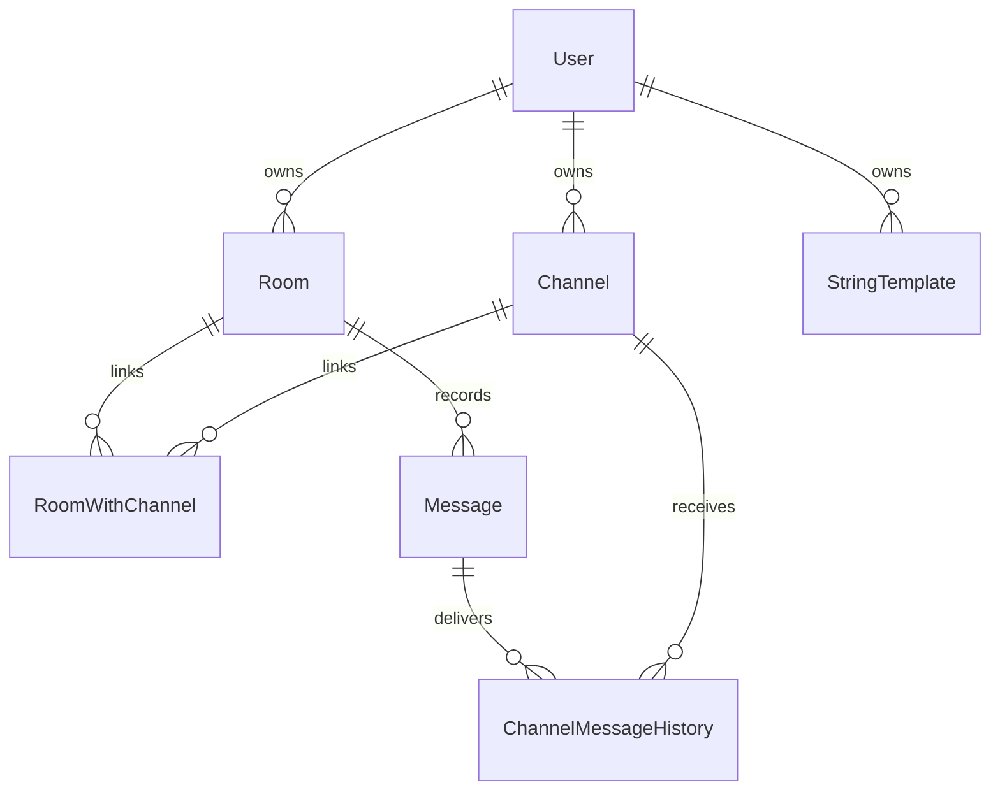
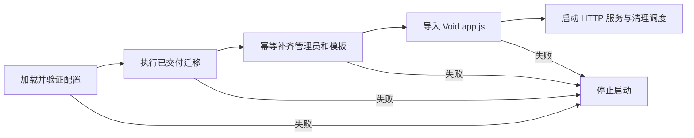

# 数据库与部署

## 目标

在保留旧数据模型和业务标识的前提下支持 MySQL 与 SQLite，通过随代码交付的 SQL 管理结构变化，确保发布前完成迁移和必要初始化。

## 边界

- 每个实例通过配置选择一种数据库：MySQL 使用 mysql2，SQLite 使用 better-sqlite3；不提供运行中切换或数据库间自动复制。
- MySQL 的数据库、账号及授权由部署环境提供。SQLite 自动创建目录和文件，使用 WAL。
- Repository 统一业务访问与数据类型；初始化和关联清理由 Service 负责，迁移工具只处理结构及显式迁移 SQL。
- 连接适配器承担 Drizzle 查询构造，各方言复用本方言内各表相同的 CRUD 实现；业务仓储不转导出 ORM 工具，保留驱动执行方式及返回值归一化的差异。

## 规则

### 配置和领域数据

- 应用和迁移命令共用根目录 `.env` 的加载与数据库配置校验。现有环境变量优先，只校验所选方言的必要配置，默认方言为 MySQL。Drizzle Kit 引入同一环境加载模块，但按显式方言配置离线生成 SQL，不需要数据库连接。
- `.env.example` 是可提交的示例；真实 `.env`、SQLite 主文件及其日志不提交到 Git、不随应用文件同步。连接串及密码不进入客户端或原始异常日志。
- MySQL、SQLite 分别维护 schema 和迁移快照，仓储对外统一数字 ID、布尔值、模板对象与时间字符串。MySQL 模板字段存储 JSON 文本，SQLite 使用 JSON 文本映射。
- 业务时间统一按 `Asia/Shanghai` 生成、存储和展示，使用不含时区后缀的毫秒精度字符串；解析时显式指定 `+08:00`，不依赖主机时区。MySQL 使用 `DATETIME(3)` 和字符串读写，驱动时区为 `+08:00`，不更改数据库全局时区；SQLite 使用相同语义。JWT 时间仍使用标准时间戳。
- 表名、字段映射、ID、角色及管道编号保留旧模型契约。房间与模板代码冲突由 Service 检查；当前 schema 没有声明业务唯一索引或外键，关联清理由 Service 承担。
- 多条业务写入没有统一事务边界，不能假设资源删除、关联替换、初始化或外发能够整体回滚。仓储提供单条限量查询、集合条件和数据库分页；房间及管道历史在数据库内计数、排序和分页，管道详情只批量读取当前页对应的消息。其他管理列表仍由 Service 筛选和分页。
- 统计查询在数据库内按归属和上海时间过滤、计数及日期分组，窗口保留最近 N×24 小时的含义，不读取消息正文、密码或管道凭据；名称按精确字符串分组，不受 MySQL 默认大小写不敏感排序规则影响。图表名称及数量由仓储统一为字符串与数字。
- MySQL 统计查询兼容 `ONLY_FULL_GROUP_BY`，排序使用聚合结果，不要求降低数据库严格模式；隔离 MySQL 集成验证显式启用该模式。

### 数据关系

图中关系是业务关系，不表示数据库已经建立外键。模板通过投递请求中的代码查找，消息不保留模板外键或模板版本。

### 结构迁移和旧库接管

- `vpr db:generate` 分别为两种方言生成 SQL 与快照；开发者审阅后随 schema 一起交付。没有结构变化时不产生空迁移，数据回填使用自定义 SQL 迁移。
- `vpr db:check` 在 `debug/` 副本中检查 schema 与已有迁移快照的一致性，不修改正式迁移。
- `vpr db:migrate` 只应用所选方言尚未执行的迁移，并执行必要初始化。迁移历史保存在 `__drizzle_migrations`，已应用 SQL 的哈希与顺序必须匹配；禁止修改已应用迁移来升级结构。
- 检测到没有迁移记录的旧业务表时停止，不直接重复建表或推测基线。MySQL 表名比较遵守 `lower_case_table_names`，兼容旧库的小写表名。
- `vpr db:baseline` 按当前方言 schema 核对表和字段，MySQL 额外校验默认值，只登记第一条迁移，不运行该条建表 SQL，不执行业务初始化。已有迁移记录时拒绝重复建立基线；后续仍需正常 migrate。
- 最后一个 .NET 版本的 MySQL 旧库通过 `db/legacy/dotnet-to-ts.mysql.sql` 一次性对齐时间精度、模板字段类型和默认值。执行前停服备份并核对旧结构，旧数据必须已使用上海时间；SQL 不修改时间值或业务标识，不处理更早版本或混入 UTC 的数据，不登记迁移历史。完成数据核对后再执行 baseline 和 migrate；新库不执行该 SQL，失败不盲目重跑。具体操作见 [.NET 旧版迁移说明](../dotnet-to-ts-migration.md)。
- 基线校验不等于完整兼容性证明。接管前在副本核对表名大小写、类型与精度、默认值、索引、字符集、排序规则和数据时间语义；不匹配时先人工完成映射及迁移方案。
- MySQL 迁移使用数据库命名锁协调迁移连接；DDL 可能部分完成后失败，不假定能够整体事务回滚。SQLite 结构重置使用事务；重置会同时重建迁移记录。

### 幂等初始化及显式重置

- 初始化保留现有非删除前缀管理员；没有管理员时，使用配置创建管理员。若同名账号已存在且不是管理员，停止并要求人工核对，不自动提权或覆盖。
- 系统模板为 Base、Lark、DingTalk、ComWechat，只补充缺失代码，不覆盖已有模板和用户密码。
- 管理员重置系统模板是独立操作，会重新生成保留代码对应的模板；数据库重置清空业务表及迁移记录后重新迁移、初始化。重置操作要求管理员权限、CSRF 和显式 `RESET` 输入，不属于正常发布流程。

## 模块职责

| 模块 | 职责 |
| --- | --- |
| `server/config.ts` | 环境文件、方言选择和必要配置校验 |
| `server/db/mysql.ts`、`server/db/sqlite.ts` | 各方言 schema 与旧字段映射 |
| `server/db/connection.ts`、`server/db/repository.ts` | Drizzle 适配、统一仓储和连接关闭 |
| `server/db/migrations.ts`、`db/migrations/` | 迁移历史、基线、重置及交付 SQL |
| `server/services/system.ts` | 管理员与模板初始化、统计及清理策略 |
| `scripts/`、`Taskfile.yml` | 数据库命令、独立启动入口、定时调度、文件发布及远端服务启停 |

## 流程

### 发布和资源生命周期

自定义服务器采用 [Void 官方文档介绍的 Programmatic Usage](https://void.cloud/integrations/nodejs-bun-deno#programmatic-usage)：通过 tsx 执行独立启动脚本，在迁移和初始化完成后导入公开的 `dist/ssr/app.js` 并提供 HTTP 服务。不替换框架生成入口、不依赖打包后的私有导出。迁移和基线命令同样运行独立 TypeScript 脚本，tsx 属于生产依赖；默认 `node dist/ssr/index.js` 不执行项目初始化和清理调度。

生产入口使用配置的 `APP_URL` origin 规范内部请求 URL，以支持 HTTPS 反向代理后的同源 Action 检查；不依赖客户端转发头决定可信来源。收到退出信号后销毁调度、等待 HTTP 服务关闭并释放启动脚本持有的数据库连接，重复信号不重复清理。源码入口与构建产物各自持有服务实例，本方案尚未统一它们的连接生命周期；进程退出释放剩余资源。开发模式不自动执行生产清理任务。

启动失败时输出失败阶段、可安全展示的配置或迁移提示及错误代码，不输出数据库驱动原始异常、连接串或 SQL。

服务器独立维护 `.env` 与 SQLite 可写数据目录，应用更新不得覆盖数据库。在线备份需保持 SQLite 主文件和 WAL 的一致性。

通过根目录 `Taskfile.yml` 直接调用 oc-rsync 和 SSH 同步部署，systemd 服务及权限由用户自行配置。Taskfile 是项目配套，不是 Void 官方部署配置。连接参数、远端 vp 路径、服务名及本机工具路径由 `.env` 提供，示例见 `.env.example`；Windows 默认使用系统 OpenSSH，其他平台默认使用 ssh。远端只需安装标准 rsync。`publish` 构建后检查远端配置、执行 `systemctl stop`、调用 `sync`、安装锁定版本的生产依赖，再执行 `systemctl start`。`sync` 同步已有运行文件并按删除开关清理过期文件，不安装依赖或启停服务；`check` 检查 SSH 连接；`exec` 在远端应用目录执行调用者指定的命令；远端 vp 不在 SSH 环境的 PATH 中时，通过本机 `.env` 的 `REMOTE_VP` 指定绝对路径。

同步包含 `dist/`、`server/`、`shared/`、`scripts/`、`db/`、`package.json` 和 `pnpm-lock.yaml`，保持目录层级。运行源码用于独立启动、初始化和清理，SQL 及迁移元数据从 `db/migrations/` 读取；服务器独立安装生产依赖。Taskfile 先排除配置和数据，再分别包含运行目录及 `目录/**`，最后排除其余路径。默认通过 oc-rsync 的 `--delete` 清理同步范围内的过期文件，`DELETE_ON_SYNC=false` 时只上传覆盖。排除的 `.env*`、依赖目录、数据目录、调试目录及 SQLite 主文件和日志均保留，其他远端根目录内容也保留；不使用 `--delete-excluded`，不使用暂存目录、清单或辅助部署脚本。

远端 Node、vp、应用配置及 systemd 服务由用户在首次部署前准备，发布账号需具备针对该服务的启停权限。Taskfile 仅调用已有服务的 `systemctl stop/start`，环境配置和数据库由服务器持久化管理。同步不是原子切换，旧服务停止后才替换文件和依赖；任何步骤失败均停止后续发布，停服后的同步或安装失败不自动重启旧代码。

旧版切换允许短暂停机：停止旧版写入和任务，完成备份，在已验证的结构上建立基线并迁移，再启动新版验收及恢复访问。任何时刻只允许一个版本写入和运行任务；失败后根据实际结构状态修复或恢复备份，再切回旧版。

### 每日清理

生产调度每天在配置时区的 02:00 执行，默认 `Asia/Shanghai`；同一进程内不重叠执行。

- 对从未登录的非管理员账号执行账号的两阶段删除规则。
- 对配置的示例账号重建业务数据；账号不存在或为管理员时跳过。
- 按消息年龄的完整天数判断，仅删除超过保留天数的消息及对应投递历史，默认保留天数为 30。

## 关键决策

- 采用版本化 SQL 和迁移记录控制数据库变化，生产入口只执行已交付 SQL，不临时生成迁移或直接同步 schema。
- 分开维护两种方言，以保留各自的驱动和存储语义；共享业务模型不能替代对两种数据库迁移的验证。
- 保留单实例部署，使进程内调度和 SQLite 文件生命周期保持可控；数据库迁移锁不代表已经支持多实例业务或任务协调。
