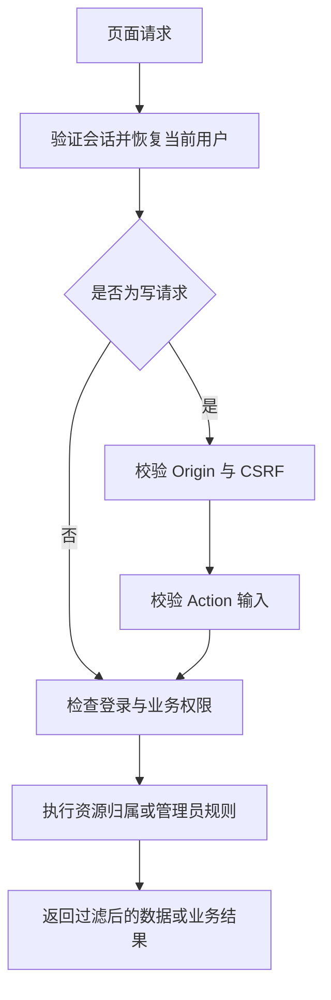

# 账号与管理

## 目标

保留旧版账号及认证兼容性，为管理页面建立明确的会话、权限、资源归属和敏感信息边界。

## 边界

本模块负责页面身份恢复、资源管理授权、账号管理和密码邮件。外部推送使用房间代码与可选密钥授权，具体规则见[消息投递](message-delivery.md)。

## 规则

### 会话与请求保护

- 登录页默认只展示登录表单；点击“注册 / 忘记密码”切换为邮箱与发送密码表单，并可返回登录。邮件发送成功后自动返回登录、填入收件邮箱并提示查收；失败时停留在邮箱表单显示错误。
- 登录使用用户名和密码，成功后记录登录时间并签发 HS256 JWT。签名密钥、Issuer 和 Audience 来自服务端配置，接管旧版时应沿用。
- JWT 放在 `pusher_session` HttpOnly Cookie 中，使用 `SameSite=Lax`；站点 `APP_URL` 为 HTTPS 时设置 Secure。Cookie 和令牌有效期由登录天数配置决定。
- 每次页面请求验证 JWT，并重新按用户名、用户 ID 查询账号，以数据库中的角色为准。角色变更无需等待旧令牌过期；不存在或已改名的账号不能继续使用原身份。
- 退出清除会话 Cookie；修改密码需要验证原密码，但当前没有主动撤销已签发 JWT 的机制。
- 退出入口位于后台侧栏底部的用户名下拉菜单；退出 Action 清除会话 Cookie 并跳转到无侧栏的登录页。
- 页面写请求必须携带与 `APP_URL` origin 完全匹配的 Origin，以及与 HttpOnly `pusher_csrf` Cookie 一致的 JSON body `csrf` 值。CSRF Cookie 使用 `SameSite=Strict`，登录和密码邮件也受此保护。
- 未登录的页面 GET 请求跳转到 `/login`；未登录的写请求拒绝执行。管理页面响应禁止缓存，并设置防嵌入与 MIME 嗅探保护。

### 权限及资源归属

- 角色沿用 `Free=0`、`VIP=1`、`Admin=100`；当前 Free 与 VIP 没有额外的业务配额差异。
- 管理用户、全局统计和系统重置要求 Admin。不能删除当前登录账号，不能取消自己的管理员权限。
- `/admin` 验证管理员身份后跳转到 `/admin/dashboard`；仪表盘、`/admin/user` 和 `/admin/db` 分别承担统计、用户管理及系统维护。每个子页面独立授权和加载数据，管理 Action 位于对应子页面，不保留原 `/admin?...` 操作地址。
- 管理列表、详情历史和历史弹窗统一使用 Nuxt UI 分页；多页时显示可点击页码、首尾页和省略号，单页或空列表只保留数量信息。页面分页保留搜索条件并通过现有导航加载，弹窗按目标页加载且加载期间禁用分页；窄屏工具栏允许换行。后台主内容滚动区域预留稳定的滚动条空间，避免长短列表切换引起横向位移。
- 用户管理分页保持服务端分页。数据库重置要求显式输入 `RESET`，失败保留提示，成功后跳转到登录页；系统模板重置保留独立操作和成功提示。
- 房间、管道和模板的管理、详情、删除、测试及页面发送都要求当前用户拥有资源；Admin 在这些个人操作中也不绕过归属校验。
- 房间只能关联同一用户拥有的管道；保存关联时去重并替换原关联集合。
- 房间详情通过常驻的 Nuxt UI Listbox 多选列表管理管道关联，支持名称搜索、固定高度滚动和虚拟列表，并显示已选数量。点击列表项切换选择，搜索不清除已有选择；点击保存后才替换服务端关联。
- 房间代码与模板代码在保存时按全库检查冲突；未填写则创建随机代码，编辑时留空保留原代码。
- 模板管理按所属用户隔离，投递时则按全局模板代码查找，因此模板代码同时承担跨账号复用的入口作用。

### 敏感字段和编辑约定

- 用户列表不返回密码；页面身份只包含用户 ID、用户名和角色。
- 房间不回显密钥，只返回是否设置；管道不回显完整地址和 JSON 配置，只返回对应的设置标记；代理地址在所属用户的编辑窗口正常回显。
- 编辑时，密钥、管道地址及配置留空表示保留原值；代理地址按输入值保存，删空后保存即移除代理，页面不提供独立清除代理按钮。移除房间密钥使用独立的显式清除操作；页面不提供清除 JSON 配置的入口。
- 管道地址按类型验证邮箱或 HTTP/HTTPS；代理必须为 HTTP/HTTPS；管道配置必须能解析为 JSON，Bark 还需通过加密参数校验。模板内容需满足变量列表与模板正文的结构要求。

### 账号生命周期

- 密码存储及邮件发送密码的方式沿用旧版：当前保存可还原的原密码，找回流程发送已有密码，不产生重置链接。改变这一规则需要单独规划账号迁移及认证契约。
- 密码邮件只接受邮箱用户名。同一账号两次发送请求至少间隔 10 分钟；不存在的账号先以随机密码创建，角色为 Free。
- 邮件发送前会记录限频时间；发送失败也不会回退本次限频记录。新建邮件账号在首次登录前，登录时间为空。
- 管理员创建用户时，附带创建示例房间、管道、关联和模板；密码邮件创建账号不执行该示例初始化。
- 删除用户采用两阶段规则：第一次将用户名加上 `delete_` 前缀，保留数据；对已有该前缀的账号再次删除，才清除关联业务数据及用户记录。页面将第一次操作称为“标记删除”，前缀不是独立的禁用状态。
- 房间删除同时清除其消息、投递历史和管道关联；管道删除清除其投递历史和房间关联，保留房间消息；模板删除只删除模板。

## 模块职责

| 模块 | 职责 |
| --- | --- |
| `middleware/01.session.ts` | Cookie、身份恢复、页面写请求保护及未登录处理 |
| `server/services/auth.ts` | 密码验证、JWT 签发与验证、当前角色和改密 |
| `server/services/users.ts` | 管理员用户操作、两阶段删除和密码邮件限频 |
| `server/services/management.ts` | 个人资源归属、保存、关联、敏感字段过滤及关联清理 |
| `server/services/system.ts` | 全局操作授权、系统初始化及定时清理策略 |
| `pages/`、`shared/validation.ts` | 页面输入约束及业务请求适配 |

## 流程

登录页允许匿名访问，但它的写操作仍经过来源、CSRF 和输入校验。

## 关键决策

- 角色从数据库恢复，使角色调整与账号改名能立即影响后续请求；JWT 并不独立承担完整授权状态。
- 房间密钥、管道地址和 JSON 配置仅写入而不回显，编辑时留空保留已有配置；房间密钥通过独立动作清除，管道代理回显并直接编辑。
- 账号、密码邮件和删除方式优先保持旧版行为；这些兼容性约束不能被误认为新的密码安全或账号停用机制。

