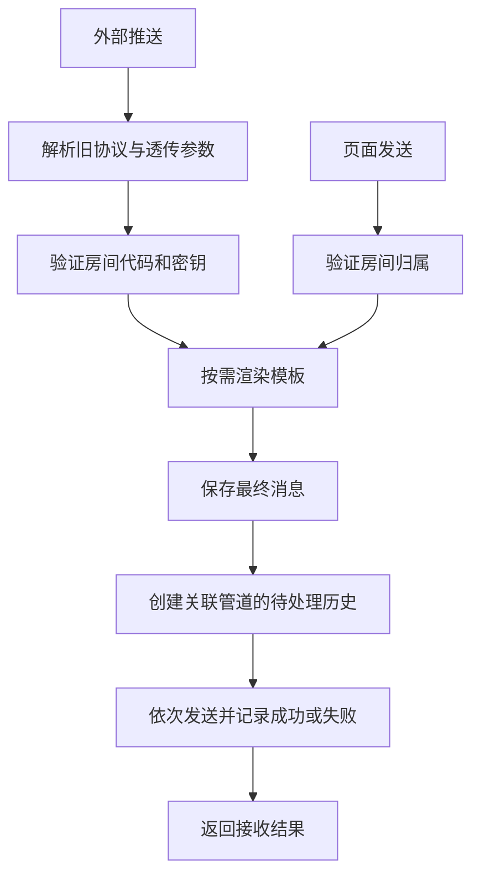

# 消息投递

## 目标

兼容旧调用方的两个消息推送入口，并让页面发送复用同一套模板、消息记录和管道发送规则。

## 边界

当前只投递文本消息。发送在请求内执行，依次调用关联管道；没有后台队列、投递恢复任务、请求幂等键或消息级自动重试。管道测试直接发送固定测试文本，不生成房间消息及投递历史。

## 规则

### 外部协议

| 方法与路径 | 输入规则 |
| --- | --- |
| `GET /pusher.webapi/Room/SendMessageByGet/:roomCode` | `content` 必填且非空白；固定文本类型；不启用模板渲染 |
| `POST /pusher.webapi/Room/SendMessageByPost/:roomCode` | 请求体必须为非 null 的有效 JSON；Query 可指定 `messageType`、`templateCode`；对象中精确名为 `content` 的字段作为正文，否则使用整个 JSON 值 |

- 房间代码来自路径，密钥来自 Query `roomKey`。房间未设置密钥时仅凭房间代码即可推送；已设置时必须匹配密钥。
- Query 中正文、密钥、类型及模板代码的读取兼容大小写，重复参数值用逗号连接。
- POST 的 `messageType` 默认 `Text`，支持名称和数字解析；仅类型 `0` 实际投递，其他已解析类型返回未接收，不生成消息。
- GET 将正文和密钥之外的 Query 参数作为附加数据，排除保留参数时也忽略大小写，房间密钥不能进入第三方载荷。POST 只透传 `title`、`group`、`icon`、`sound`、`url`、`isarchive`、`level`、`badge`、`autocopy`、`copy`、`volume`；Body 同名字段覆盖 Query，匹配时忽略大小写。
- JSON 对象、数组和数字正文保留原 JSON 文本的空格、换行及数字表达；Webhook 直接发送该正文，不额外包装或重新序列化。
- 正常处理返回 HTTP 200 和 `{ code: 20000, message: 'Success', data: '房间<roomCode>接收请求：True/False' }`。房间不存在、密钥错误或消息类型不支持时，结果为 False。
- 参数错误和处理异常也沿用 HTTP 200，通过 `code: 50000` 与错误消息表达。页面 Action 的 HTTP 错误语义不用于这两个旧接口。
- True 表示接收并完成投递处理，不表示所有管道发送成功。没有关联管道的房间仍保存消息并返回 True。

### 模板

- 模板由全局唯一代码定位，内容包含 JSONPath 变量定义和 Handlebars 正文；推送时不按模板所属用户限制查找。
- 输入不能解析成 JSON 时，用包含正文的对象作为模板数据。对象正文与附加数据合并时，正文中的字段优先。
- 每个变量取 JSONPath 的第一个匹配；无匹配或无效路径得到空字符串。Handlebars 保留默认 HTML 转义行为。
- 指定的模板不存在时，渲染结果为空字符串，仍按正常消息落库与投递。页面发送可使用模板代码，GET 入口不渲染模板。

### 模板编辑与预览

- 模板列表使用 UTable，新建和编辑使用响应式宽弹窗。表单分别编辑名称、代码、可增删的变量名与 JSONPath 行及 Handlebars 正文，不要求用户编辑配置 JSON。
- 编辑草稿与列表数据隔离，取消不修改原模板，保存失败保留草稿。保存仍提交 `value` 字符串，其 `Variables` / `TemplateText` 结构及数据库格式保持兼容；变量必填错误定位到对应字段，不因编辑器而增加路径语法等保存限制。
- `/templates?preview` 是受登录、Origin 和 CSRF 保护的页面 Action，只接收当前草稿与样例正文，不根据全局代码查找模板。它使用与生产投递相同的渲染器，返回变量首项提取值、未命中或非法路径状态、最终正文及普通文本处理提示。
- 预览不保存模板、不写消息或投递历史、不调用管道。结果仅随当次页面响应返回，不持久化；保留列表筛选与分页。草稿或样例变化后，旧结果明确标记为过期，模板语法错误以表单错误展示。

### 记录与失败语义

- 一次有效投递创建一条房间消息，保存最终渲染的正文；再为每个关联管道创建一条初始历史。
- 历史 `status=0` 表示待处理，`status=1` 表示处理结束；是否成功由独立的 `success` 字段表示，`result` 保存失败说明。
- 单个管道发送失败会写入失败历史，并继续处理其他管道；数据库错误可中断请求，已写入或已外发的操作不整体回滚。
- 重复请求可能产生重复消息及外发；进程中断可能留下待处理历史，当前不自动恢复。HTTP 传输层的重试也可能造成重复外发。
- 历史只保存应用生成的受控失败说明，不持久化第三方原始错误文本，避免响应回显凭据或超过旧数据库结果字段长度。

### 八种管道

类型编号是旧数据契约，不得随展示顺序调整。

| 编号 | 管道 | 发送与判定规则 |
| --- | --- | --- |
| 0 | 钉钉 | 文本 JSON，HTTP 成功且明确返回业务错误码 0 才成功 |
| 1 | 企业微信 | 文本 JSON，HTTP 成功且明确返回业务错误码 0 才成功 |
| 2 | 飞书 | 文本 JSON，HTTP 成功且明确返回业务码 0 才成功 |
| 3 | Telegram | 从管道 URL 提取 chatId 和可选线程 ID，合并附加数据，按 HTTP 状态判定 |
| 4 | Bark | 正文、默认标题与分组可由附加数据覆盖；可配置 AES128/256 CBC/ECB 加密；按 HTTP 状态判定 |
| 5 | 邮箱 | 管道地址为收件邮箱，使用服务端 SMTP 配置及可选代理 |
| 6 | Webhook | 原样 POST 最终正文，按 HTTP 状态判定 |
| 7 | Qmsg | JSON 正文字段为 msg，HTTP 成功且响应 success 为 true 才成功 |

Bark 的加密模式、密钥字节长度和显式 CBC IV 长度在保存及发送时校验；选择加密模式后，配置无效必须拒绝，不能回退为明文发送。

HTTP 管道支持独立代理。直连有总时限及单次时限，对网络错误和指定临时状态最多重试三次；代理模式使用单次发送及独立时限。邮件使用独立 SMTP 超时策略。以上重试不是持久化投递保证。

## 模块职责

| 模块 | 职责 |
| --- | --- |
| 两个推送 Server Route、`server/push-http.ts` | 旧协议解析、正文保真、透传参数和兼容响应 |
| `server/services/push.ts` | 房间访问验证、页面发送归属、模板渲染、消息及投递历史 |
| `server/template-renderer.ts` | 投递与预览共用的正文解析、变量提取和 Handlebars 渲染 |
| `server/services/channels.ts` | 管道载荷、Bark 加密、业务响应判定及 HTTP 传输 |
| `server/services/mail.ts` | SMTP 配置、代理、超时和连接释放 |

## 流程

## 关键决策

- 保持旧 URL、业务码和接收语义，使旧调用方无需迁移到新的管理接口。
- 消息与各管道结果分别持久化，使一次接收可对应多条独立发送结果。
- 使用请求内顺序投递控制实现范围；若改为队列或并发投递，需要重新定义响应时机、去重、失败恢复及历史状态。

