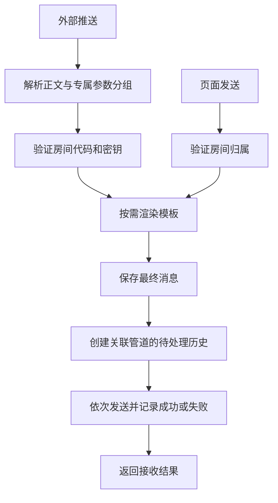

# 消息投递

## 目标

兼容旧调用方的两个消息推送入口，并让页面发送复用同一套模板、消息记录和管道发送规则。

## 边界

当前只投递文本消息。发送在请求内执行，依次调用关联管道；没有后台队列、投递恢复任务、请求幂等键或消息级自动重试。管道测试直接发送固定测试文本，不生成房间消息及投递历史。

## 规则

### 外部协议

| 方法与路径 | 输入规则 |
| --- | --- |
| `GET /pusher.webapi/Room/SendMessageByGet/:roomCode` | `content` 必填且非空白；固定文本类型；不启用模板渲染 |
| `POST /pusher.webapi/Room/SendMessageByPost/:roomCode` | 请求体必须为非 null 的有效 JSON；Query 可指定 `messageType`、`templateCode`；对象中精确名为 `content` 的字段作为正文，否则使用整个 JSON 值 |

- 房间代码来自路径，密钥来自 Query `roomKey`。房间未设置密钥时仅凭房间代码即可推送；已设置时必须匹配密钥。
- Query 中正文、密钥、类型及模板代码的读取兼容大小写，重复参数值用逗号连接。
- POST 的 `messageType` 默认 `Text`，支持名称和数字解析；仅类型 `0` 实际投递，其他已解析类型返回未接收，不生成消息。
- GET 专属参数使用 `channelOptions.<渠道标识>.<字段>=值`，大小写敏感、禁止重复，仅支持标量字段；值以字符串进入对应适配器。不支持 JSON 形式的 `channelOptions` Query。
- POST 专属参数仅从 Body 的 `channelOptions` 对象读取，保留 JSON 类型；携带该字段时必须有非 null 的 `content`。不携带时继续兼容原 JSON 正文提取规则。
- `channelOptions` 的结构和渠道标识由入口校验，错误在落库前拒绝；字段和类型由对应适配器校验，错误只使该渠道投递失败。旧平铺字段不再参与透传；POST Query 中的渠道参数不读取。
- `channelOptions` 不进入模板数据、最终正文或历史。一次请求按渠道类型提供参数，同类型实例共享本次覆盖值，各自使用独立默认配置。
- JSON 对象、数组和数字正文保留原 JSON 文本的空格、换行及数字表达；Webhook 直接发送该正文，不额外包装或重新序列化。
- 正常处理返回 HTTP 200 和 `{ code: 20000, message: 'Success', data: '房间<roomCode>接收请求：True/False' }`。房间不存在、密钥错误或消息类型不支持时，结果为 False。
- 参数错误和处理异常也沿用 HTTP 200，通过 `code: 50000` 与错误消息表达。页面 Action 的 HTTP 错误语义不用于这两个旧接口。
- True 表示接收并完成投递处理，不表示所有管道发送成功。没有关联管道的房间仍保存消息并返回 True。

### 模板

- 模板由全局唯一代码定位，内容包含 JSONPath 变量定义和 Handlebars 正文；推送时不按模板所属用户限制查找。
- 输入不能解析成 JSON 时，用包含正文的对象作为模板数据；模板只读取正文，不合并渠道专属参数。
- 每个变量取 JSONPath 的第一个匹配；无匹配或无效路径得到空字符串。Handlebars 保留默认 HTML 转义行为。
- 指定的模板不存在时，渲染结果为空字符串，仍按正常消息落库与投递。页面发送可使用模板代码，GET 入口不渲染模板。

### 模板编辑与预览

- 模板列表使用 UTable，新建和编辑使用响应式宽弹窗。表单分别编辑名称、代码、可增删的变量名与 JSONPath 行及 Handlebars 正文，不要求用户编辑配置 JSON。
- 编辑草稿与列表数据隔离，取消不修改原模板，保存失败保留草稿。保存仍提交 `value` 字符串，其 `Variables` / `TemplateText` 结构及数据库格式保持兼容；变量必填错误定位到对应字段，不因编辑器而增加路径语法等保存限制。
- `/templates?preview` 是受登录、Origin 和 CSRF 保护的页面 Action，只接收当前草稿与样例正文，不根据全局代码查找模板。它使用与生产投递相同的渲染器，返回变量首项提取值、未命中或非法路径状态、最终正文及普通文本处理提示。
- 预览不保存模板、不写消息或投递历史、不调用管道。结果仅随当次页面响应返回，不持久化；保留列表筛选与分页。草稿或样例变化后，旧结果明确标记为过期，模板语法错误以表单错误展示。

### 记录与失败语义

- 一次有效投递创建一条房间消息，保存最终渲染的正文；再为每个关联管道创建一条初始历史。
- 历史 `status=0` 表示待处理，`status=1` 表示处理结束；是否成功由独立的 `success` 字段表示，`result` 保存失败说明。
- 单个管道发送失败会写入失败历史，并继续处理其他管道；数据库错误可中断请求，已写入或已外发的操作不整体回滚。
- 重复请求可能产生重复消息及外发；进程中断可能留下待处理历史，当前不自动恢复。HTTP 传输层的重试也可能造成重复外发。
- 历史只保存应用生成的受控失败说明，不持久化第三方原始错误文本，避免响应回显凭据或超过旧数据库结果字段长度。

### 八种管道

类型编号是旧数据契约，不得随展示顺序调整。

下表只记录项目已接入的出站能力；钉钉、飞书为自定义机器人，企业微信为消息推送（原群机器人）。代码接入和本地验证不等于真实第三方端到端验收。

| 编号 | 管道 | 已实现能力 | 发送与判定规则 |
| --- | --- | --- | --- |
| 0 | 钉钉 | 文本；前端配置签名密钥，发送时自动加签 | 毫秒时间戳与签名放入 URL；HTTP 成功且明确返回业务错误码 0 才成功 |
| 1 | 企业微信 | 文本；通过 Webhook 地址中的 key 认证；直接正文可包含手写的 `<@userid>` 标记 | 文本 JSON，HTTP 成功且明确返回业务错误码 0 才成功 |
| 2 | 飞书 | 文本；前端配置签名密钥，发送时自动加签；直接正文可包含手写的 `<at>` 标记 | 秒时间戳与签名放入 Body；HTTP 成功且明确返回业务码 0 才成功 |
| 3 | Telegram | 文本；固定聊天及可选线程；HTML、Markdown、MarkdownV2；静默通知；内容保护；部分 entities | 从管道 URL 提取 chatId 和可选 message_thread_id；专属字段不能覆盖目标及正文，按 HTTP 状态判定 |
| 4 | Bark | 标题、副标题、分组、图标、铃声、通知级别、音量、角标、跳转及复制参数；前端配置 AES128/256 CBC/ECB 加密 | 正文与专属参数组成载荷后按配置加密；CBC 请求携带实际 IV；按 HTTP 状态判定 |
| 5 | 邮箱 | 单收件人纯文本邮件；自定义标题；全局 SMTP 认证、TLS 和渠道代理 | 管道地址为收件邮箱，使用服务端 SMTP 配置；邮件发送调用完成视为成功 |
| 6 | Webhook | HTTP/HTTPS POST；原样正文；固定 JSON Content-Type；渠道代理 | 原样 POST 最终正文，不包装或重新序列化，按 HTTP 状态判定 |
| 7 | Qmsg | JSON 文本发送；使用管道地址中的 API Key | JSON 正文字段为 msg；HTTP 成功且响应 success 为 true 才视为提交成功，不表示 QQ 已最终送达 |

Bark 的加密模式、密钥字节长度和显式 CBC IV 长度在保存及发送时校验；选择加密模式后，配置无效必须拒绝，不能回退为明文发送。

钉钉和飞书的签名用于请求认证，Bark 加密用于保护消息正文，二者是独立能力。直接正文中的 @ 标记随文本发送，模板仍保留默认 HTML 转义；这不等于提供了结构化的 @成员配置。

Qmsg 3.0 使用 JSON 推送地址 `/v3/jsend/{key}`；渠道地址由用户配置，当前发送器只提交 JSON，并按提交响应记录结果。

### 渠道专属参数与配置

静态注册表使用 `dingtalk`、`wecom`、`feishu`、`telegram`、`bark`、`mail`、`webhook`、`qmsg` 对应旧编号 0–7。每个适配器负责配置、参数、协议载荷及结果判定，入口不维护渠道字段白名单。

| 渠道 | 当前支持的消息参数 |
| --- | --- |
| Bark | title、subtitle、group、icon、sound、url、copy、level、badge、volume、isarchive、autocopy |
| Telegram | parse_mode、disable_notification、protect_content、disable_web_page_preview；POST 另支持 entities 数组 |
| 邮箱 | subject |
| 其他 | 暂无，非空参数对象会使对应渠道失败 |

- Bark 和邮箱上述消息参数均提供前端默认值编辑；Telegram 的解析模式、静默通知、内容保护和旧版链接预览开关提供前端编辑，entities 数组仅通过 POST 专属参数提交。
- Telegram entities 的当前字段范围为 type、offset、length、url、language、custom_emoji_id；offset 为非负整数，length 为正整数。链接预览当前实际发送字段为 `disable_web_page_preview`。
- Bark 表中 `isarchive`、`autocopy` 是当前实现接受并组包的字段名；参数表描述项目行为，不表示所有目标服务端和客户端版本均已联调通过。
- 参数按协议默认值、渠道默认参数、本次参数覆盖，只覆盖已支持字段；数组整体替换，不做深层合并。未知字段拒绝，不直接透传。
- GET 布尔值仅接受 `true` / `false`，整数字段接受十进制整数字符串；POST 可用原生类型。Bark badge 为非负整数、volume 为 0–10、isarchive / autocopy 为 0 或 1；level 为 active、timeSensitive、passive 或 critical。
- 地址、目标身份、代理和安全凭据只来自持久配置，专属参数不得覆盖。Bark 的 `url` 是点击跳转地址，不是发送目标。
- `config` 使用 `{ version: 1, settings, defaults }`；settings 保存渠道协议配置，defaults 保存通过适配器校验的默认消息参数。沿用现有 TEXT 字段，不更改数据库结构。
- 初始化通过 Repository 幂等转换旧配置，两种数据库复用同一逻辑；旧 Bark 加密配置转换为 settings，空配置转为默认配置。无法识别的配置保留原值，页面标记无效，发送拒绝；不自动重置或明文降级。无效配置必须通过页面显式重置后才能保存，服务端同样校验该操作。初始化仅记录无效数量。读取和发送也能解释尚未持久转换的旧配置。
- Bark 的随机 CBC IV 使用 16 字节 ASCII 表达，并随 ciphertext 一起发送；固定 IV 同样随请求发送。密钥按 UTF-8 字节长度校验，使用 PKCS#7 填充。
- 渠道配置页面使用结构化字段；完整渠道地址、代理独立字段、配置密钥及默认消息参数仅向所属用户返回，并在编辑时以普通文本回显和直接修改。字段元数据供页面使用，服务端适配器是校验权威。
- 保存配置采用 `{ settings, defaults }`，配置字段按当前表单替换，空的可选密钥不写入配置；代理使用启用开关及协议、服务器、端口、用户名、密码独立字段；开启时显示字段，服务器和有效端口必填，认证可选。关闭后保存为直连并清空代理字段，不提供操作模式选择。切换渠道类型必须重新提供目标地址，旧类型密钥不能继承。
- 凭据仍保存在数据库，静态加密独立规划；配置读取与编辑受资源归属校验保护，不声称已有静态加密。

协议依据：[钉钉消息类型](https://open.dingtalk.com/document/orgapp/custom-bot-send-message-type.md)、[钉钉安全设置](https://open.dingtalk.com/document/orgapp/customize-robot-security-settings.md)、[企业微信消息推送](https://developer.work.weixin.qq.com/document/path/91770)、[飞书自定义机器人](https://open.feishu.cn/document/client-docs/bot-v3/add-custom-bot)、[Telegram Bot API](https://core.telegram.org/bots/api#sendmessage)、[Bark 参数](https://github.com/Finb/Bark/blob/master/docs/params.md)、[Bark 加密](https://github.com/Finb/Bark/blob/master/docs/encryption.md)、[Qmsg 接口](https://qmsg.zendee.cn/docs)、[Nodemailer 消息配置](https://nodemailer.com/message)、[SMTP](https://nodemailer.com/smtp)、[HTTP 标准](https://www.rfc-editor.org/rfc/rfc9110.html#name-post)。

HTTP 管道支持独立代理。数据库分别保存 ProxyEnabled、ProxyProtocol、ProxyHost、ProxyPort、ProxyUsername、ProxyPassword，不再保存完整代理 URL。协议支持 HTTP/HTTPS，端口为 1–65535；未配置时默认关闭，表单初始协议为 HTTP、端口为 8080。密码非空时需要用户名，用户名不能包含冒号。旧 URL 仅在一次性数据库迁移中拆分，运行时不识别旧字段；调用 HTTP 或 SMTP 库时按新字段临时组装并编码认证 URL。直连有总时限及单次时限，对网络错误和指定临时状态最多重试三次；代理模式使用单次发送及独立时限。邮件使用独立 SMTP 超时策略。以上重试不是持久化投递保证。

## 模块职责

| 模块 | 职责 |
| --- | --- |
| 两个推送 Server Route、`server/push-http.ts` | 入口解析、正文保真、专属参数结构和兼容响应 |
| `server/services/push.ts` | 房间访问验证、页面发送归属、模板渲染、消息及投递历史 |
| `server/template-renderer.ts` | 投递与预览共用的正文解析、变量提取和 Handlebars 渲染 |
| `server/services/channels.ts` | 选择适配器、合并默认参数、受控结果与公共 HTTP 传输 |
| `server/channels/` | 静态注册表、版本化配置、独立渠道协议和参数校验、所属用户配置读取 |
| `shared/channels.ts` | 渠道标识、公共参数分组结构和无密钥的表单字段元数据 |
| `server/services/mail.ts` | SMTP 配置、代理、超时和连接释放 |

## 流程

## 关键决策

- 保持旧 URL、业务码和接收语义，使旧调用方无需迁移到新的管理接口。
- 消息与各管道结果分别持久化，使一次接收可对应多条独立发送结果。
- 使用请求内顺序投递控制实现范围；若改为队列或并发投递，需要重新定义响应时机、去重、失败恢复及历史状态。

